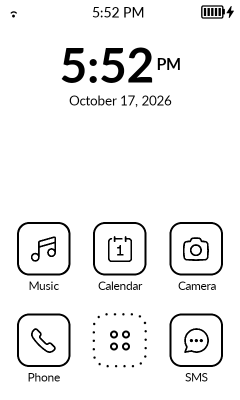
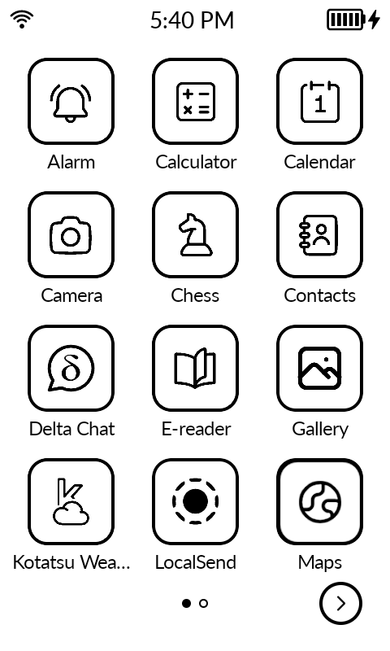
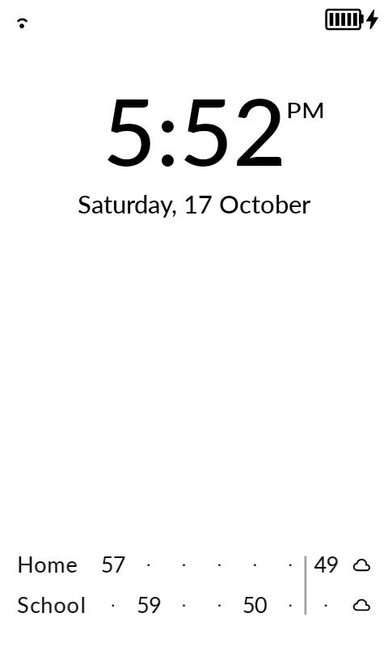
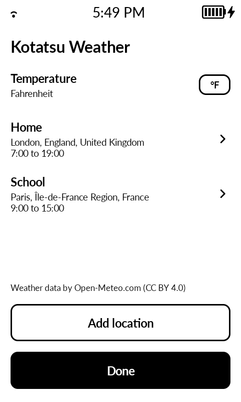
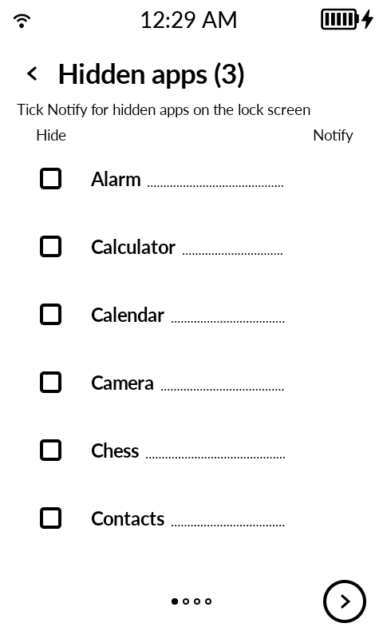
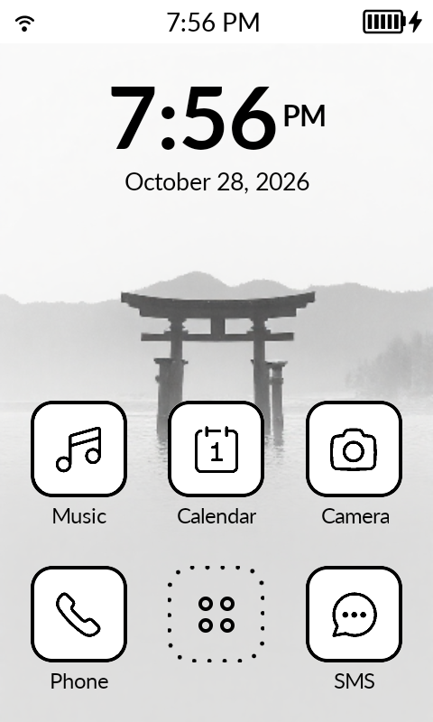
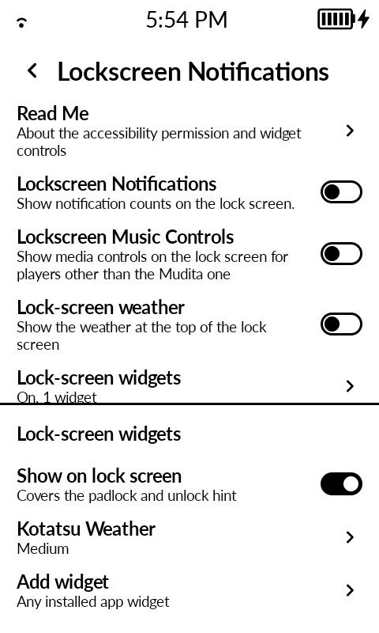
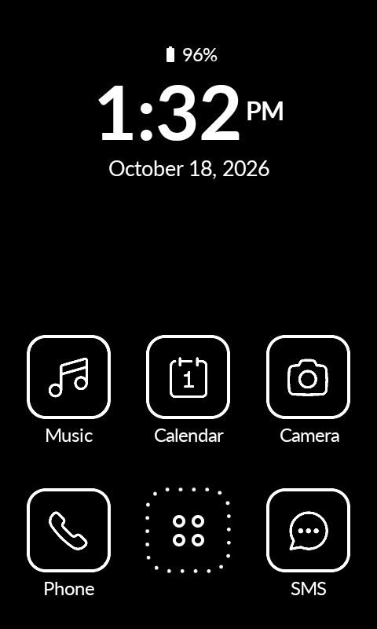

<div align="center">
	<picture>
		<source media="(prefers-color-scheme: dark)" srcset="docs/img/kotatsu_w.svg">
		
	</picture>
	<h2>Kotatsu — a comfortable launcher.</h2>
</div>

Kotatsu is a privacy-focused Android launcher for the Mudita Kompakt e-ink phone: a spacious clock, a simple app grid, monochrome icons and a useful lock screen. Make it your own with offline icon collections, optional access controls and installed app widgets.

**The launcher has no Internet permission or built-in updater.** Kotatsu Weather is a separate, optional app that uses the network.

[Download the latest release](https://github.com/alexindigo/kotatsu/releases/latest) · [Website](https://alexindigo.github.io/kotatsu/) · [What's new in 0.2](CHANGELOG.md)

Kotatsu on a Mudita Kompakt:

<div align="center">
    <table>
        <tr>
            <td></td>
            <td></td>
            <td></td>
            <td></td>
        </tr>
        <tr>
            <td></td>
            <td></td>
            <td></td>
            <td></td>
        </tr>
    </table>
</div>

## Features

- **A simple home and app grid.** Large clock and date, Phone/SMS dock, an optional row of three shortcuts, music information and controls, battery percentage, and swipe or page-arrow navigation. Arrows stop at the ends even when swipe wrapping is on.
- **2,174 offline icon choices.** Search Simple Icons, Tabler and Material collections, import PNG/SVG artwork, or reset an icon. Reviewed brand matches and hand-picked stock line icons apply automatically; other apps keep their original icons. Manual choices take priority. See the [icon catalogue](docs/ICON_CATALOGUE.md).
- **A consistent e-ink look.** Rounded-square or circle app icons, round buttons and page arrows, light/dark/system themes, optional wallpaper and text backgrounds, and home-button refresh to clear ghosting.
- **Setup at your pace.** Finish onboarding without sensitive grants or changing the default launcher. Sensitive access has separate choices for collecting badges, media information and usage statistics, and for notification dismissal, call acknowledgment, media controls and accessibility features.
- **Quiet app lists.** Hide, rename and reorder apps. Settings → All Apps separates Hidden Apps from Kompakt System Apps. Stock apps omitted by Mudita's launcher, app stores, FUTO Keyboard and Mudita's Update start hidden and can be shown individually. Hidden apps stay off the lock screen unless their separate Notify box is ticked; lock-screen exclusions still take precedence.
- **A useful lock screen.** On Kompakt, host installed Android app widgets in a configurable box over the padlock and unlock hint. Choose widget size and order. Optional experimental lock-screen notifications show per-app counts. These features need the Kotatsu Action Service.
- **Changes you can review.** Reordering asks Save, Discard or Cancel on an unsaved exit. Settings import validates the file before replacing settings and asks before changing sensitive-access choices; failed icon or wallpaper replacements keep the saved choice.
- **Optional screensaver (experimental).** Shows the home clock, date, alarm, battery and up to four notification rows. Select Kotatsu in Android's Screen saver settings; start it from the home long-press menu or with a two-finger long-press. The power button exits.

## Install

Requires **Android 11 or newer** (API 30). Kompakt-specific integration, including lock-screen widget hosting, is designed for the Mudita Kompakt.

Get the APKs from [Kotatsu Releases](https://github.com/alexindigo/kotatsu/releases/latest). The [v0.2 release](https://github.com/alexindigo/kotatsu/releases/tag/v0.2) includes:

| # | APK | Install for |
|---|---|---|
| 1 | [kotatsu-v0.2.apk](https://github.com/alexindigo/kotatsu/releases/download/v0.2/kotatsu-v0.2.apk) | The launcher |
| 2 | [kotatsu-weather-v0.2.apk](https://github.com/alexindigo/kotatsu/releases/download/v0.2/kotatsu-weather-v0.2.apk) | Optional weather widget; separate app with network access |

Open the downloaded APK on the phone and allow installation from that source when Android asks. Open Kotatsu to preview it; choose it as the default Home app in Android settings when ready. Updates are installed manually from Releases.

The release APK signing certificate's **SHA-256** is:

```text
8fa0f259c8cf159d9fa4d995ab1b55fae7eb3c463a249b985b20107edfbbf607
```

This is the certificate fingerprint, not an APK file checksum. With Android SDK Build Tools installed, inspect an APK using `apksigner verify --print-certs kotatsu-v0.2.apk`.

## Kotatsu Weather

Kotatsu Weather is optional and installed separately. It fetches weather from [Open-Meteo](https://open-meteo.com/) using the network; the launcher does not fetch its weather.

Add up to four places by search or a one-off current-location request. Each place has its own label and hours, shown as a line of temperatures. Choose Celsius or Fahrenheit. Open the Kotatsu Weather app icon to edit the settings.

On Kompakt, open launcher Settings → Lockscreen → Lock-screen widgets, enable the Kotatsu Action Service using the setup guide, and add Kotatsu Weather. Leave Android's floating accessibility shortcut off. Other installed Android app widgets can be added to the same host.

## Setup and everyday use

| # | Action | How |
|---|---|---|
| 1 | Open Settings | Long-press an empty area of Home |
| 2 | Replace a home shortcut | Long-press Phone, SMS or an extra-row shortcut |
| 3 | Assign clock/date shortcuts | Long-press the clock or date |
| 4 | Change an app | Long-press it in All Apps for Rename, Change Icon, Hide or Reorder |
| 5 | Reorder | Tap another app to swap, then Save; Reset edits the draft |

Back exits a nondefault launcher preview after internal navigation and dialogs are resolved. Clock and date formats can follow Android's System setting or use a chosen format. If Action Service access is lost, Kotatsu names the affected features and offers to turn them off.

## Privacy and permissions

The launcher has **no Internet permission and no built-in updater**. Apps and providers opened from Kotatsu (including browsers, document providers and Mudita weather handoffs) can network independently. Android-managed backup and device transfer remain enabled. This is a launcher permission boundary, not a promise that the whole phone is offline.

Android grants and Kotatsu's Sensitive access choices are separate: a grant alone does not replace your in-app choices. Ordinary launcher preview use does not require notification access, SMS/call access, usage access, accessibility or default-Home selection.

| # | Access | Purpose |
|---|---|---|
| 1 | `QUERY_ALL_PACKAGES` | List installed apps |
| 2 | `REQUEST_DELETE_PACKAGES` | Ask Android to uninstall an app from its context menu |
| 3 | `WRITE_SETTINGS` | Optional double-tap brightness control |
| 4 | Notification listener | Optional badge counts and media information; dismissal and media controls have separate in-app choices |
| 5 | `READ_CALL_LOG`, `READ_SMS` | Optional direct Phone/Messages badge counts on supported Kompakt devices |
| 6 | `WRITE_CALL_LOG` | Separate, deliberate call acknowledgment action |
| 7 | Usage access (`PACKAGE_USAGE_STATS`) | Optional most-recent / most-used app sorting |
| 8 | Kotatsu Action Service (accessibility) | Optional lock-screen overlays/widgets, clock cover, locking and screensaver features |

Kotatsu Weather separately declares Internet and network-state access. Location access is optional for Add current location: a one-off fix while setup is open, never a background location request. Search for a place instead to avoid granting location access.

## Build from source

Use JDK 21 and the Android SDK for compile SDK 36.1. The Gradle wrapper supplies the project's Gradle version.

```sh
git clone https://github.com/alexindigo/kotatsu.git
cd kotatsu
./gradlew :app:assembleDebug :kotatsu-weather:assembleDebug
```

Debug APKs are written under `app/build/outputs/apk/debug/` and `kotatsu-weather/build/outputs/apk/debug/`. Release builds use `:app:assembleRelease :kotatsu-weather:assembleRelease` with `KEYSTORE_FILE`, `KEYSTORE_PASSWORD`, `KEY_ALIAS` and `KEY_PASSWORD` set for your own signing key. A self-signed build cannot replace an installed release signed with a different key.

## Troubleshooting

### Notification indicator not showing
Go to Settings > Notification Log and check if the notification exists in Android. Many apps require Google Play Services for push notifications. If it's not in the log, it doesn't exist for Android and Kotatsu can't read it.

### Notification not clearing
Check the Notification Log. If Android doesn't clear it, Kotatsu can't either.

### How to disable notification dots for a specific app
For ordinary app dots, go to Settings > App Notifications, tap the app, and disable "Allow notification dot". Lock-screen notifications have separate controls, including the hidden-app Notify choice described above.

## Credits and licences

Kotatsu is based on [Katapult by gezimos](https://github.com/gezimos/Katapult), [GPL-3.0](LICENSE).

| # | Work | Attribution / licence |
|---|---|---|
| 1 | Lato Regular and Bold | Łukasz Dziedzic; [SIL Open Font License 1.1](LICENSE-Lato.txt) |
| 2 | Simple Icons | [CC0-1.0](app/src/main/assets/icons/notices/simple-license.md); [per-logo disclaimer](app/src/main/assets/icons/notices/simple-disclaimer.md), including brand/trademark restrictions |
| 3 | Tabler Icons | Paweł Kuna; [MIT](app/src/main/assets/icons/notices/tabler-license.txt) |
| 4 | Material Icons | Google; [Apache-2.0](app/src/main/assets/icons/notices/material-license.txt) |
| 5 | AndroidSVG 1.4 | Paul LeBeau / Cave Rock Software Ltd.; [Apache-2.0](app/src/main/assets/icons/notices/androidsvg-LICENSE) |
| 6 | Weather data | [Open-Meteo](https://open-meteo.com/); [CC BY 4.0](https://creativecommons.org/licenses/by/4.0/) |

See the [icon catalogue](docs/ICON_CATALOGUE.md) for provenance and packaged notices, and [Kotatsu Weather's NOTICE](kotatsu-weather/NOTICE) for its Material weather icons and Mudita-derived app icon. The accessibility-overlay approach was inspired by [Lockscreen Widgets](https://github.com/zacharee/LockscreenWidgets) by Zachary Wander; no code was copied.
