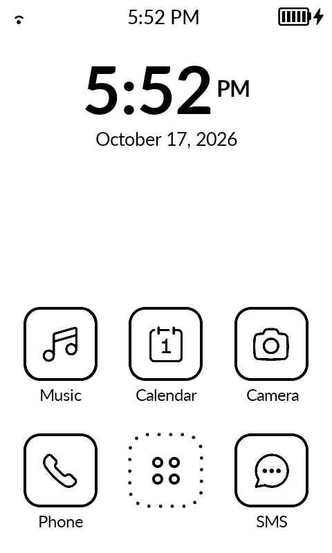
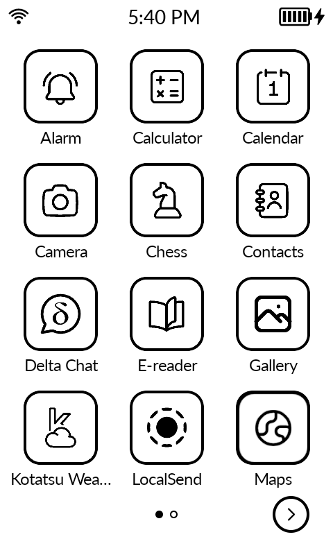
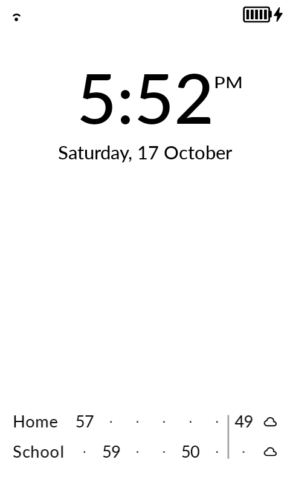
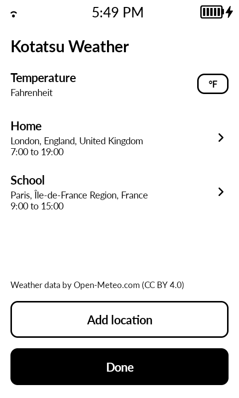
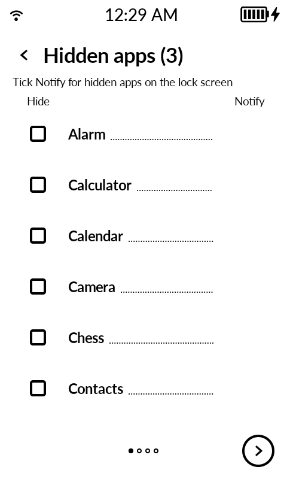
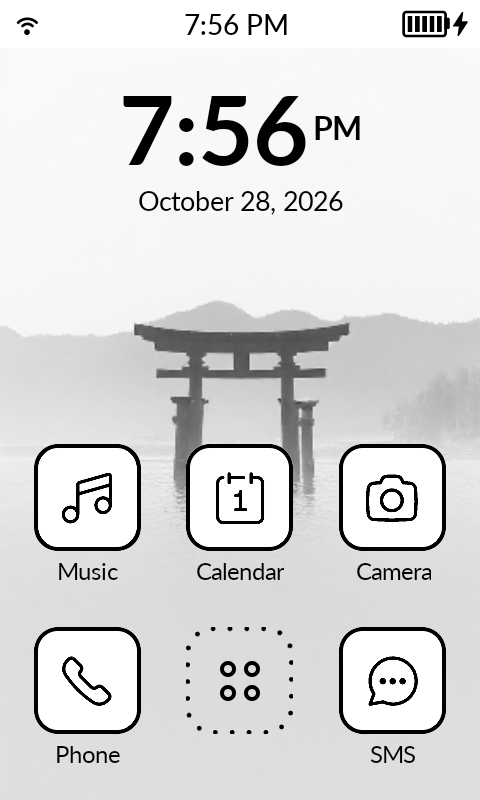
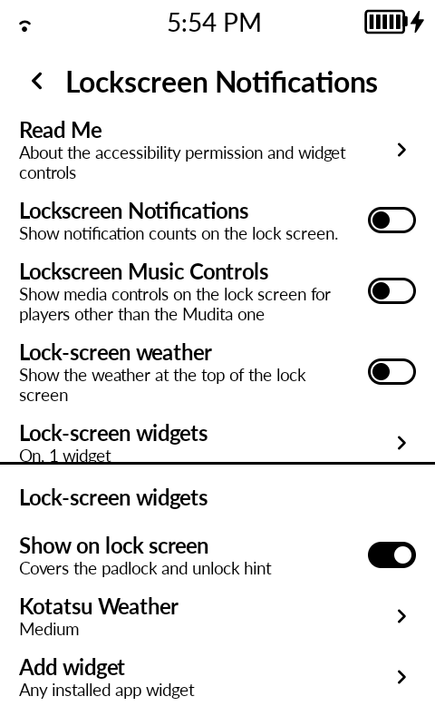
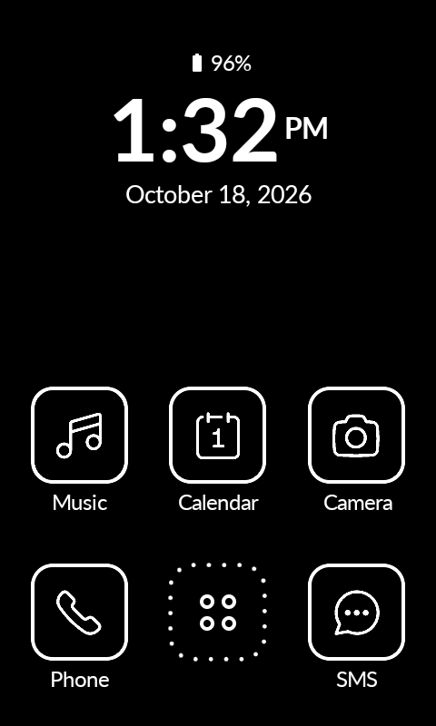

<div align="center">
	<picture>
		<source media="(prefers-color-scheme: dark)" srcset="docs/img/kotatsu_w.svg">
		
	</picture>
	<h2>Kotatsu — a comfortable launcher.</h2>
</div>

Kotatsu is a privacy-focused Android launcher for the Mudita Kompakt e-ink phone: a spacious clock, a simple app grid, monochrome icons and a useful lock screen. Make it your own with offline icon collections, optional access controls and installed app widgets.

**The launcher has no Internet permission or built-in updater.** Kotatsu Weather is a separate, optional app that uses the network.

[Download the latest release](https://github.com/alexindigo/kotatsu/releases/latest) · [Website](https://alexindigo.github.io/kotatsu/) · [What's new in 0.6.1](CHANGELOG.md)

Kotatsu on a Mudita Kompakt:

<div align="center">
    <table>
        <tr>
            <td></td>
            <td></td>
            <td></td>
            <td></td>
        </tr>
        <tr>
            <td></td>
            <td></td>
            <td></td>
            <td></td>
        </tr>
    </table>
</div>

## Features

- **A simple home and app grid.** Large clock and date, Phone/SMS dock, an optional row of three shortcuts, music information and controls, battery percentage, and swipe or page-arrow navigation. Arrows stop at the ends even when swipe wrapping is on.
- **2,174 offline icon choices.** Search Simple Icons, Tabler and Material collections, import PNG/SVG artwork, or reset an icon. Reviewed brand matches and hand-picked stock line icons apply automatically; other apps keep their original icons. Manual choices take priority. See the [icon catalogue](docs/ICON_CATALOGUE.md).
- **A consistent e-ink look.** Rounded-square or circle app icons, round buttons and page arrows, light/dark/system themes, and home-button refresh to clear ghosting. Home stays readable over any wallpaper, with automatic black-or-white ink that follows the picture underneath. Pick the built-in Kotatsu wallpaper or your own photo in Settings › Appearance › Wallpaper or from the Home long-press menu, or leave it at None.
- **Setup at your pace.** Finish onboarding without sensitive grants or changing the default launcher. Sensitive access has separate choices for collecting badges, media information and usage statistics, and for notification dismissal, call acknowledgment, media controls and accessibility features.
- **Quiet app lists.** Hide, rename and reorder apps. Settings → All Apps separates Hidden Apps from Kompakt System Apps. Stock apps omitted by Mudita's launcher, app stores, FUTO Keyboard and Mudita's Update start hidden and can be shown individually. Hidden apps stay off the lock screen unless their separate Notify box is ticked; lock-screen exclusions still take precedence.
- **A useful lock screen.** On Kompakt, host installed Android app widgets in a configurable box over the padlock and unlock hint. Choose widget size and order. Optional experimental lock-screen notifications show per-app counts. These features need the Kotatsu Action Service.
- **A side screen for widgets.** Swipe in from an edge to open a named screen, with one Full widget or a Split top/bottom pair. A scroll rail appears beside scrollable lists.
- **Optional Notes widget.** Kotatsu Notes supplies a Mudita Notes task list you can check without unlocking. The launcher hosts the widget; Kotatsu Notes reads and saves the list.
- **Optional Weather widget.** Every place fits on one line, with an icon for the whole selected interval and an update time when the forecast is over an hour old.
- **Changes you can review.** Reordering asks Save, Discard or Cancel on an unsaved exit. Settings import validates the file before replacing settings and asks before changing sensitive-access choices; failed icon or wallpaper replacements keep the saved choice.
- **Optional screensaver (experimental).** Shows the home clock, date, alarm, battery and up to four notification rows. Select Kotatsu in Android's Screen saver settings; start it from the home long-press menu or with a two-finger long-press. The power button exits.

## Install

Requires **Android 11 or newer** (API 30). Kompakt-specific integration, including lock-screen widget hosting, is designed for the Mudita Kompakt.

Get the APKs from [Kotatsu Releases](https://github.com/alexindigo/kotatsu/releases/latest). The [v0.6.1 release](https://github.com/alexindigo/kotatsu/releases/tag/v0.6.1) includes:

| # | APK | Install for |
|---|---|---|
| 1 | [kotatsu-v0.6.1.apk](https://github.com/alexindigo/kotatsu/releases/download/v0.6.1/kotatsu-v0.6.1.apk) | The launcher |
| 2 | [kotatsu-weather-v0.6.1.apk](https://github.com/alexindigo/kotatsu/releases/download/v0.6.1/kotatsu-weather-v0.6.1.apk) | Optional weather widget; separate app with network access |
| 3 | [kotatsu-notes-v0.6.1.apk](https://github.com/alexindigo/kotatsu/releases/download/v0.6.1/kotatsu-notes-v0.6.1.apk) | Optional Mudita Notes task-list and quote widgets; separate app |

Release asset names follow `kotatsu-v<version>.apk`, `kotatsu-weather-v<version>.apk` and `kotatsu-notes-v<version>.apk`.

Open the downloaded APK on the phone and allow installation from that source when Android asks. Open Kotatsu to preview it; choose it as the default Home app in Android settings when ready. Updates are installed manually from Releases.

The release APK signing certificate's **SHA-256** is:

```text
8fa0f259c8cf159d9fa4d995ab1b55fae7eb3c463a249b985b20107edfbbf607
```

This is the certificate fingerprint, not an APK file checksum. With Android SDK Build Tools installed, inspect an APK using `apksigner verify --print-certs kotatsu-v0.6.1.apk`.

## Kotatsu Weather

Kotatsu Weather is optional and installed separately. It fetches weather from [Open-Meteo](https://open-meteo.com/) using the network; the launcher does not fetch its weather.

Add up to four places by search or a one-off current-location request. Each place has its own label and hours, shown as a line of temperatures. Choose Celsius or Fahrenheit. Open the Kotatsu Weather app icon to edit the settings.

On Kompakt, open launcher Settings → Lockscreen → Lock-screen widgets, enable the Kotatsu Action Service using the setup guide, and add Kotatsu Weather. Leave Android's floating accessibility shortcut off. Other installed Android app widgets can be added to the same host.

## Setup and everyday use

| # | Action | How |
|---|---|---|
| 1 | Open Settings | Long-press an empty area of Home |
| 2 | Replace a home shortcut | Long-press Phone, SMS or an extra-row shortcut |
| 3 | Assign clock/date shortcuts | Long-press the clock or date |
| 4 | Change an app | Long-press it in All Apps for Rename, Change Icon, Hide or Reorder |
| 5 | Reorder | Tap another app to swap, then Save; Reset edits the draft |

Back exits a nondefault launcher preview after internal navigation and dialogs are resolved. Clock and date formats can follow Android's System setting or use a chosen format. If Action Service access is lost, Kotatsu names the affected features and offers to turn them off.

Double-press Home within 400 ms to open Recent apps. The newest app sits at the bottom; scroll up for older apps.
Tap an app name to switch to it. Close, or swipe a row left by at least a third of its width, to stop its background
processes and hide it until it is used again. Close all asks for confirmation in the top line. Back cancels that
confirmation; otherwise Back or another double-press returns to the app or Home where you started.
Recent apps uses the existing usage-statistics choice and Android usage access.

### Edge swipes on the lock screen and Home

On Kompakt, open Settings > Lock screen > Edge swipes and enable the Kotatsu Action Service when prompted.
Choose Side screen, Camera or Nothing for each edge. The defaults are Side screen on the left and Camera on the right.
These same settings also apply on Home, without requiring the Action Service there.
Enable on home screen is On by default; turn it Off to keep edge actions only on the lock screen.
Swipe inward from the screen edge by at least one third of the screen width
to run its action. Short sideways swipes do nothing; taps and vertical swipes pass to the lock screen after release.
The strips are absent over the PIN pad, other apps and while the screen is off.

On Home, Camera opens the normal still-image camera and widget apps open directly without an unlock step.
On the lock screen, the camera action uses Android's secure camera intent. Settings reports when no compatible secure camera is installed.
The camera app may need its own lock-screen option: for Open Camera, grant its camera permission, then enable
Settings > More camera controls > Show camera when locked. Kotatsu does not unlock the phone.

Open Side screen in the Edge swipes page to choose its widgets, screen name and layout: Full for one widget,
or Split for a top/bottom pair. The name defaults to the widget's name. Each scrollable list has its own rail,
with arrows and a draggable thumb. The screen opens with a six-step slide-in preview. Close it with the top-bar
close button, Back or a swipe toward its opening edge by one third of the screen width. It also closes on
screen-off, unlock, PIN entry or another app covering the lock screen.
A widget tap that opens an app usually asks for the phone's normal unlock first.
Android does not always report that launch to Kotatsu; then nothing appears on the lock screen,
and the app is already open after the next unlock. The phone stays locked either way.
Taps that work in place, such as ticking a Kotatsu Notes task, are not affected.

### Kotatsu Notes

Kotatsu Notes is a separate, optional app. Add its Task list widget to the side screen and choose one Mudita Notes
task list in the widget's setup page. Check and uncheck items while locked; long items wrap, and the side screen's
rail scrolls the list. Kotatsu Notes reads only task-list titles for the picker and the selected list for the widget.
Each toggle conditionally updates the list and re-reads its persisted state; a stale displayed list is refreshed
without writing its old checks. Unlock once after a restart to make the list available.

An editor left open in Mudita Notes can still overwrite these checks when saved; its main list may not refresh
immediately after an external check. Kotatsu Notes does not edit text or add tasks. Kotatsu itself no longer reads
Mudita Notes.

## Privacy and permissions

The launcher has **no Internet permission and no built-in updater**. Apps and providers opened from Kotatsu (including browsers, document providers and Mudita weather handoffs) can network independently. Android-managed backup and device transfer remain enabled. This is a launcher permission boundary, not a promise that the whole phone is offline.

Android grants and Kotatsu's Sensitive access choices are separate: a grant alone does not replace your in-app choices. Ordinary launcher preview use does not require notification access, SMS/call access, usage access, accessibility or default-Home selection.

| # | Access | Purpose |
|---|---|---|
| 1 | `QUERY_ALL_PACKAGES` | List installed apps |
| 2 | `REQUEST_DELETE_PACKAGES` | Ask Android to uninstall an app from its context menu |
| 3 | `WRITE_SETTINGS` | Optional double-tap brightness control |
| 4 | Notification listener | Optional badge counts and media information; dismissal and media controls have separate in-app choices |
| 5 | `READ_CALL_LOG`, `READ_SMS` | Optional direct Phone/Messages badge counts on supported Kompakt devices |
| 6 | `WRITE_CALL_LOG` | Separate, deliberate call acknowledgment action |
| 7 | Usage access (`PACKAGE_USAGE_STATS`) | Optional most-recent / most-used app sorting and Recent apps |
| 8 | Kotatsu Action Service (accessibility) | Optional lock-screen overlays/widgets, edge actions and gesture passthrough, clock cover, locking and screensaver features |
| 9 | `KILL_BACKGROUND_PROCESSES` | Close background app processes from Recent apps |

Kotatsu Weather separately declares Internet and network-state access. Location access is optional for Add current location: a one-off fix while setup is open, never a background location request. Search for a place instead to avoid granting location access.

Kotatsu Notes separately declares Mudita `READ_NOTES` and `WRITE_NOTES` to list task-list titles and read and
check/uncheck the selected list. The launcher declares neither Notes permission. Kotatsu Notes has no Internet
permission.

## Build from source

Use JDK 21 and the Android SDK for compile SDK 36.1. The Gradle wrapper supplies the project's Gradle version.

```sh
git clone https://github.com/alexindigo/kotatsu.git
cd kotatsu
./gradlew :app:assembleDebug :kotatsu-weather:assembleDebug :kotatsu-notes:assembleDebug
```

Debug APKs are written under each app's `build/outputs/apk/debug/`: `app/`, `kotatsu-weather/` and `kotatsu-notes/`. Release builds use `:app:assembleRelease :kotatsu-weather:assembleRelease :kotatsu-notes:assembleRelease` with `KEYSTORE_FILE`, `KEYSTORE_PASSWORD`, `KEY_ALIAS` and `KEY_PASSWORD` set for your own signing key. A self-signed build cannot replace an installed release signed with a different key.

See [release tooling](docs/RELEASE_TOOLING.md) for the three-APK identity gate, build receipts and asset naming.

## Troubleshooting

### Notification indicator not showing
Go to Settings > Notification Log and check if the notification exists in Android. Many apps require Google Play Services for push notifications. If it's not in the log, it doesn't exist for Android and Kotatsu can't read it.

### Notification not clearing
Check the Notification Log. If Android doesn't clear it, Kotatsu can't either.

### How to disable notification dots for a specific app
For ordinary app dots, go to Settings > App Notifications, tap the app, and disable "Allow notification dot". Lock-screen notifications have separate controls, including the hidden-app Notify choice described above.

## Credits and licences

Kotatsu is based on [Katapult by gezimos](https://github.com/gezimos/Katapult), [GPL-3.0](LICENSE).

| # | Work | Attribution / licence |
|---|---|---|
| 1 | Lato Regular and Bold | Łukasz Dziedzic; [SIL Open Font License 1.1](LICENSE-Lato.txt) |
| 2 | Simple Icons | [CC0-1.0](app/src/main/assets/icons/notices/simple-license.md); [per-logo disclaimer](app/src/main/assets/icons/notices/simple-disclaimer.md), including brand/trademark restrictions |
| 3 | Tabler Icons | Paweł Kuna; [MIT](app/src/main/assets/icons/notices/tabler-license.txt) |
| 4 | Material Icons | Google; [Apache-2.0](app/src/main/assets/icons/notices/material-license.txt) |
| 5 | AndroidSVG 1.4 | Paul LeBeau / Cave Rock Software Ltd.; [Apache-2.0](app/src/main/assets/icons/notices/androidsvg-LICENSE) |
| 6 | Weather data | [Open-Meteo](https://open-meteo.com/); [CC BY 4.0](https://creativecommons.org/licenses/by/4.0/) |

See the [icon catalogue](docs/ICON_CATALOGUE.md) for provenance and packaged notices, and [Kotatsu Weather's NOTICE](kotatsu-weather/NOTICE) for its Material weather icons and Mudita-derived app icon. The accessibility-overlay approach was inspired by [Lockscreen Widgets](https://github.com/zacharee/LockscreenWidgets) by Zachary Wander; no code was copied.
